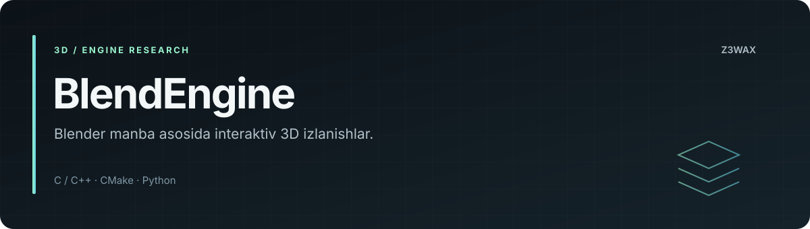

<!-- z3wax:presentation:start -->


[Loyiha xaritasi va misol](docs/PROJECT_GUIDE.md) · [Roadmap](ROADMAP.md) · [Baholash](docs/EVALUATION.md) · [Changelog](CHANGELOG.md) · [Relizlar](docs/RELEASING.md)

[](https://github.com/z3wax/BlendEngine/actions/workflows/documentation.yml)

**Tekshiruvlar:** [Documentation workflow](https://github.com/z3wax/BlendEngine/actions/workflows/documentation.yml)

Hujjatlar CI holati dastur yoki model testlari holatidan alohida.
<!-- z3wax:presentation:end -->

# BlendEngine

Blender manba kodiga tayangan, o'yin ishlab chiqish va interaktiv 3D ish jarayonlarini o'rganishga yo'naltirilgan engine loyihasi.

**Grafika:** [High/Cinematic rejimlari, namuna sahna va ishga tushirish](docs/GRAPHICS.md).

**Editor va o'yin:** [Native editor, Neon Relay va runtime optimizatsiyasi](docs/PERFORMANCE_EDITOR.md).

**Repozitoriy egasi:** [z3wax](https://github.com/z3wax)  
**Asos:** Blender va uning uchinchi tomon komponentlari.

## Holat

Repozitoriy Blender manba daraxti va build vositalarini o'z ichiga oladi. O'yinga yo'naltirilgan editor, runtime va eksport yo'nalishlari rivojlantirish maqsadlari sifatida baholanadi; bu README ularning barchasi tayyor ekanini da'vo qilmaydi.

## Manba tuzilmasi

| Yo'l | Vazifasi |
|---|---|
| [source/](source/) | Asosiy ilova va editor manbasi |
| [intern/](intern/) | Ichki kutubxonalar |
| [extern/](extern/) | Uchinchi tomon komponentlari |
| [scripts/](scripts/) | Python modullari va skriptlar |
| [build_files/](build_files/) | Build muhiti va yordamchi vositalar |
| [tests/](tests/) | Test materiallari |
| [CMakeLists.txt](CMakeLists.txt) | CMake konfiguratsiyasi |

## Kodni olish

```bash
git clone --recurse-submodules https://github.com/z3wax/BlendEngine.git
cd BlendEngine
```

Mavjud nusxada submodullar uchun:

```bash
git submodule update --init --recursive
```

## Yig'ish

Bu oddiy Python paket yoki bir faylli dastur emas. C/C++ kompilyator, CMake va platformaga mos dependency to'plami kerak. [build_files/](build_files/), [GNUmakefile](GNUmakefile) va [make.bat](make.bat) dagi mavjud build oqimiga amal qiling. Bog'liqliklarni tayyorlagandan keyingi umumiy CMake shakli:

```bash
cmake -S . -B ../blendengine-build
cmake --build ../blendengine-build --parallel
```

Aniq generator, kutubxona yo'llari va build opsiyalari operatsion tizimga bog'liq. Yuqoridagi buyruqlar barcha platformada qo'shimcha sozlamasiz build o'tishini kafolatlamaydi. Natijalar source katalogidan tashqarida saqlanadi.

## O'zgarishlarni tekshirish

Editor, render yoki runtime o'zgarishida platforma, kompilyator, build turi va qayta chiqarish faylini yozing. Faqat muvaffaqiyatli buildni funksional test natijasi sifatida ko'rsatmang. Mavjud testlarni va ta'sirlangan sahna oqimini alohida tekshiring.

## Mualliflik va litsenziya

Blender asosidagi kodning mualliflik va litsenziya bildirishnomalari saqlanadi. [COPYING](COPYING) va [GNU GPL matni](doc/license/GPL-license.txt) asosiy manbalar; alohida uchinchi tomon komponentlarining shartlari ham amal qiladi. Repozitoriy egasi ko'rsatilishi barcha upstream kodning yakka muallifligini anglatmaydi.

## Hissa qo'shish

[CONTRIBUTING.md](CONTRIBUTING.md). Har bir o'zgarishda upstreamga tegishli qism va BlendEnginega xos qismni aniq tushuntiring.
