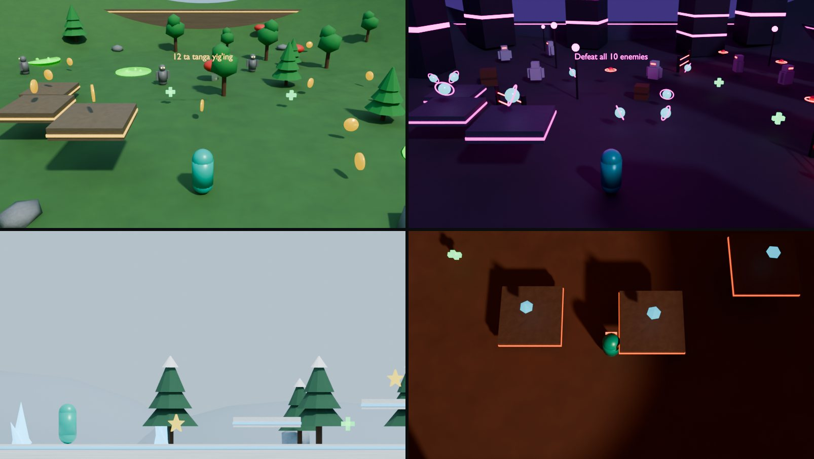

# BlendEngine AI Game Creator

[README](../README.md) · [Grafika](GRAPHICS.md) · [Roadmap](../ROADMAP.md) · [Changelog](../CHANGELOG.md)

G'oyangizni oddiy so'zlar bilan yozing — BlendEngine undan o'ynaladigan level
quradi: dunyo, qahramon, dushmanlar, yig'iladigan buyumlar, xavfli zonalar,
g'alaba sharti va no-code qoidalar. Natija oddiy BlendEngine sahnasi: uni
Inspector va Logic sahifalarida tahrirlash, Play Mode'da o'ynash va Ship orqali
eksport qilish mumkin.



Rasm: offline rejalashtiruvchi quyidagi g'oyalardan yaratgan o'yinlar (chapdan
o'ngga, yuqoridan pastga): o'zbekcha o'rmon sarguzashti, inglizcha neon shahar
jangi, 2D qorli platformer va ruscha "вид сверху" vulqon o'yini. Rasm headless
muhitda Blender 4.2 Cycles (CPU, 40 namuna) bilan render qilingan; o'yinning
o'zi Play Mode'da EEVEE bilan ishlaydi.

## Ishlatish

1. BlendEngine qo'shimchasini yoqing. 3D View yon panelidagi **BlendEngine**
   yorlig'ida birinchi bo'lim — **AI Game Creator**. Xuddi shu oqim Top Bar
   **BlendEngine > AI Create Game**, Studio dashboarddagi **AI Create** va
   **Create** sahifasida ham bor.
2. **Describe your game** maydoniga g'oyani istalgan tilda yozing yoki misol
   tugmasini bosing (O'rmon, Neon FPS, 2D Qor, Kosmos).
3. **Designer**: `Auto` — API kalit sozlangan bo'lsa Claude, aks holda offline
   rejalashtiruvchi; `Claude` — faqat Claude; `Offline` — internet va kalitsiz.
4. **Platform**ni tanlang (Android/iOS/Web uchun 1 GB rejimi qo'llanadi).
5. **Create Game with AI** tugmasini bosing. Claude o'ylayotganda Blender
   bloklanmaydi; holat panelda ko'rinadi, **Cancel** bilan kutishni to'xtatish mumkin.
6. **Play** — o'yinni sinash. G'alaba yoki mag'lubiyat (`Victory` / `Game Over`)
   holat qatorida chiqadi. **Stop** yoki `Esc` dan keyin sahna boshlang'ich
   holatiga qaytadi: o'yinchi joyiga qaytadi, yig'ilgan buyumlar yana ko'rinadi.

O'yinni yaratgandan keyin:

| Tugma | Vazifasi |
|---|---|
| **Change something** | O'zgartirish so'rovi: `ko'proq dushman, tunda bo'lsin, boss qo'sh`. Joriy dizayn saqlanadi, faqat aytilgan qism o'zgaradi. |
| **New Layout** | Xuddi shu dizaynni boshqa tasodifiy joylashuv bilan qayta quradi (AI chaqirilmaydi). |
| **Spec** | Yaratilgan o'yin spetsifikatsiyasini (JSON) Text Editor'da ochadi. |
| **Rebuild From Spec Text** | Qo'lda tahrirlangan spec'dan o'yinni qayta quradi. |
| **Build Game Package** | Mavjud Ship eksportini ishga tushiradi. |

**Replace Scene** yoqilgan bo'lsa (odatiy), joriy sahna obyektlari o'chiriladi;
amal `Ctrl+Z` bilan qaytariladi. Play Mode ishlayotganda yoki Edit Mode'da yangi
o'yin qurilmaydi.

### Misollar

| G'oya | Natija |
|---|---|
| `O'rmonda 12 ta tanga yig'adigan, bo'rilardan qochadigan 3D o'yin` | O'rmon, 12 ta tanga, bo'rilar, "12 ta tanga yig'ing" maqsadi |
| `2D platformer in a snowy world, collect 15 stars and reach the portal, hard` | Yon ko'rinish, platformalar, 15 yulduzdan keyin ochiladigan portal |
| `First person zombie shooter in a neon city at night, kill all zombies` | Birinchi shaxs, qurol va o'q-dori, barcha zombilarni yengish |
| `Kosmosda 90 soniya omon qolish, o'zga sayyoraliklar va lazer tuzoqlari, boss bilan` | Koinot, lazer to'siqlari, boss, 90 soniyalik taymer |
| `Сделай игру в пустыне: собери 8 кристаллов, скорпионы и шипы` | Sahro, 8 ta kristall, chayonlar, tikanli tuzoqlar |

## Claude'ni ulash

1. **Edit > Preferences > Add-ons > BlendEngine** ni oching.
2. **Install Claude SDK** — rasmiy `anthropic` Python paketini pip orqali
   Blender'ning foydalanuvchi `scripts/modules` papkasiga o'rnatadi (internet kerak).
3. **Anthropic API Key** maydoniga kalitni kiriting yoki Blender'ni
   `ANTHROPIC_API_KEY` muhit o'zgaruvchisi bilan ishga tushiring. Kalit Blender
   sozlamalarida saqlanadi, `.blend` fayllarga yozilmaydi.
4. **Model** odatda `claude-opus-5-5`. **Design Effort**: `Fast` (low),
   `Balanced` (medium, odatiy), `Thorough` (high).

Claude'ga faqat g'oya matni, tanlangan platforma va o'zgartirish so'rovida joriy
spec yuboriladi; sahna fayllari yoki boshqa ma'lumot yuborilmaydi. So'rov
structured outputs (JSON Schema) bilan yuboriladi, shuning uchun javob doim
yaroqli JSON bo'ladi; keyin `normalize_spec` har bir qiymatni chegaralaydi.
Xavfsizlik klassifikatori rad etsa, so'rov server tomonda tavsiya etilgan
modelga qayta yo'naltiriladi (`fallbacks: "default"`). Har bir so'rov sizning
Anthropic hisobingizdan haq oladi.

Xatolar (noto'g'ri kalit, internet yo'q, limit) panelda ko'rsatiladi. `Auto`
rejimida Claude ishlamasa, o'yin offline rejalashtiruvchi bilan quriladi va bu
haqda ogohlantirish chiqadi.

## Offline rejalashtiruvchi

Internet va kalitsiz ishlaydi. O'zbek (lotin, `'`, `ʻ`, `’` belgilari bilan),
ingliz va rus tillaridagi kalit so'zlarni taniydi:

- **Dunyo:** o'rmon, sahro/cho'l, qor/muz, shahar/neon, kosmos, zindon/g'or,
  orol/dengiz, vulqon/lava, shirinlik, dala/qishloq.
- **Dushmanlar:** zombi, robot, dron, maxluq, o'zga sayyoralik, arvoh, skelet,
  bo'ri, o'rgimchak, chayon, qaroqchi, ninja, soqchi, ajdar, boss.
- **Buyumlar:** tanga, olmos/kristall, yulduz, energiya, kalit, xazina, meva.
- **Xavflar:** lava, tikan/tuzoq, zahar/kislota, lazer.
- **Maqsad:** yig' (collect), portal/chiqish (exit), yo'q qil/yeng (defeat),
  omon qol (survive).
- **Sonlar va vaqt:** `12 ta tanga`, `10 zombies`, `90 soniya`, `2 minutes`.
- **Kamera va uslub:** `2D`/platformer, birinchi shaxs, yuqoridan (top-down),
  oson/qiyin, tun/kun botishi, katta/kichik dunyo, qurol/otish.
- Qo'shtirnoq ichidagi matn o'yin nomiga aylanadi: `"Lava Lords"`.

Offline rejalashtiruvchi gaplarni emas, kalit so'zlarni tushunadi; murakkab
g'oyalar uchun Claude yaxshiroq natija beradi.

## O'yin spetsifikatsiyasi

Ikkala rejalashtiruvchi bir xil JSON formatni yaratadi
([ai_game_spec.py](../scripts/addons_core/blendengine/ai_game_spec.py)):

| Maydon | Qiymatlar |
|---|---|
| `dimension`, `camera` | `3D`/`2D`; `THIRD_PERSON`, `FIRST_PERSON`, `TOP_DOWN`, `SIDE_VIEW` (faqat 2D) |
| `world` | 10 ta mavzu, kun vaqti, o'lcham 24–120 m, tepaliklar, ranglar `#RRGGBB` |
| `player` | shakl, rang, tezlik 1–15 m/s, sakrash, sog'liq, `can_shoot` |
| `enemies` | 4 tagacha guruh, jami 24 tagacha; xulq: patrol, follow, attack, guard, flee, boss |
| `collectibles` | 3 tagacha guruh, jami 40 tagacha; tanga, olmos, yulduz, sfera, kalit, sandiq |
| `hazards` | jami 12 tagacha; lava, tikan, zahar, lazer |
| `props` | jami 80 tagacha manzara obyekti |
| `platforms`, `health_pickups` | 16 va 8 tagacha |
| `goal` | `COLLECT_ALL`, `REACH_EXIT`, `DEFEAT_ALL`, `SURVIVE`; ixtiyoriy vaqt chegarasi |
| `messages`, `design_notes` | O'yinchi va ijodkor uchun matnlar (so'rov tilida) |

Imkonsiz kombinatsiyalar avtomatik tuzatiladi: masalan, `DEFEAT_ALL` uchun
dushman bo'lmasa qo'shiladi va otish yoqiladi.

## Sahna qanday quriladi

- Barcha geometriya `bmesh` bilan protsedural yaratiladi; tashqi model yoki
  tekstura kerak emas. Takrorlanuvchi obyektlar (daraxt, tanga, dushman) bitta
  mesh'ni bo'lishadi va instancing nomzodi sifatida belgilanadi.
- Har bir buyum Trigger Zone va no-code qoidalarga ega:
  `On Enter Trigger (Player) → Add To Variable Collected/Score → Collect Object → Show Log`.
- Maqsadlar ham oddiy qoidalar: `COLLECT_ALL` va `DEFEAT_ALL` o'yinchidagi
  `Variable Compare → Win Game`; `REACH_EXIT` portal triggeri; `SURVIVE` va
  vaqt chegarasi `AI_GameDirector` obyektidagi `On Timer` qoidalari.

Bu ish uchun engine'ga qo'shilganlar:

- Yangi no-code amallar: **Add To Variable**, **Collect Object**, **Win Game**;
  NPC uchun **Attack Damage**. Yangi amallar ro'yxat oxiriga qo'shilgan, eski
  `.blend` fayllardagi qiymatlar o'zgarmaydi.
- Play Mode to'xtaganda sahna holati (joylashuv, ko'rinish, sog'liq,
  o'zgaruvchilar) tiklanadi; o'yin davomida yaratilgan nusxalar o'chiriladi.
- Yer aniqlash obyekt o'rtasidan pastga qarab nur otadi: o'yinchi platformalarga
  qo'nadi va ularning ostidan yura oladi.
- Side Scroller boshqaruvida `W/S` chuqurlikka harakatlantirmaydi; 2D'da
  patrul dushmanlari X o'qi bo'ylab yuradi.
- Sahnada `blendengine_world_bounds` bo'lsa, o'yinchi va NPC shu chegarada qoladi.
- HUD maqsad, yig'ilganlar soni va vaqtni ko'rsatadi; bo'sh **Attack Key**
  hujumni o'chiradi; yengilgan dushman qayta hisoblanmaydi.

## Buyruq qatori

```bash
blender -b --factory-startup --python tools/blendengine/ai_create_game.py -- \
  --prompt "O'rmonda 12 ta tanga yig'adigan, bo'rilardan qochadigan o'yin" \
  --output /tmp/forest_game.blend --spec-out /tmp/forest_game.json --platform WEB --package
```

`--provider auto|claude|offline`, `--model`, `--effort`, `--seed` va
`--spec fayl.json` (rejalashtirishsiz qayta qurish) ham mavjud. Claude uchun
`ANTHROPIC_API_KEY` o'qiladi.

## Tekshirish

```bash
# Blender kerak emas
python3 tests/python/blendengine_ai_spec.py

# Blender 3.6+ yoki PyPI bpy moduli
blender -b --factory-startup --python-exit-code 1 --python tests/python/blendengine_ai_creator.py
```

Linuxda Blender 4.2.23 LTS (PyPI `bpy` moduli, Python 3.11) bilan 22 ta
integratsion test o'tdi. Ular har bir maqsadni headless rejimda haqiqiy
`GameSession` orqali o'ynab yutadi, xavf, davolash, dushman zarbasi, vaqt
chegarasi, platformalar, 2D harakat, chegaralar, Stop'dan keyingi tiklash, UI
chizish kodi, saqlash/qayta ochish va Web eksportni tekshiradi. 31 ta unit test
Python 3.11 + `anthropic` 2.6.0 bilan o'tdi; Python 3.10 da 26 tasi o'tdi, 5 ta
Claude testi SDK yo'qligi sababli o'tkazib yuborildi. Claude so'rovi soxta
klient bilan tekshirilgan (so'rov shakli, sxema, refusal, kesilgan javob, ulanish
xatosi); haqiqiy API chaqiruvi va Blender 3.6 binary bilan sinov bu o'zgarishda
bajarilmagan.

## Hozirgi chegaralar

- Runtime'da to'qnashuv javobi yo'q: o'yinchi va dushmanlar devor va
  manzaradan o'tib ketadi; dunyo chegarasi faqat arenadan chiqishni to'xtatadi.
- Dushmanlar XY tekisligida harakatlanadi, shuning uchun arena o'rtasi tekis
  qoldiriladi.
- Shakllar oddiy protsedural primitivlar; animatsiya, ovoz va import qilingan
  modellar yaratilmaydi.
- Web eksport hali ham soddalashtirilgan 2D ko'rinish (preview).
