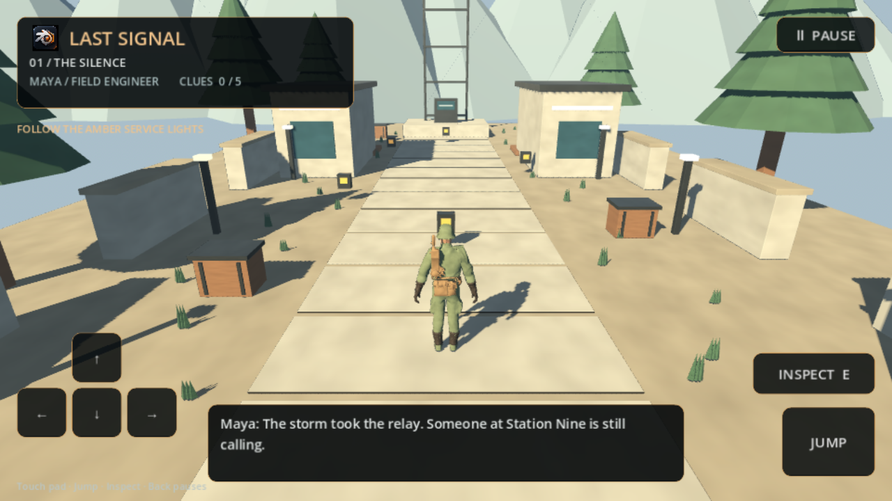

# Last Signal / native Android

Last Signal Androidda Godot 4.6.3 ning C++ runtime'i va OpenGL ES rendererida
ishlaydi. O'yin browser yoki WebView ichida ochilmaydi; lokal 3D sahna,
CharacterBody3D fizikasi, skelet animatsiyasi va sensorli UI ishlaydi. Internet
ruxsati talab qilinmaydi. Blender desktop editor bo'lib qoladi.

## Tayyor APK va boshqaruv

[LastSignal-debug.apk](https://github.com/z3wax/BlendEngine/releases/download/last-signal-native-048fbac2/LastSignal-debug.apk) — ARM64 telefonlar
va x86_64 emulatorlar uchun universal, development imzoli APK. Android 7.0 /
API 24 yoki yangi versiya, OpenGL ES 3 qo'llovi kerak. Target API 36.
[SHA-256](https://github.com/z3wax/BlendEngine/releases/download/last-signal-native-048fbac2/LastSignal-debug.apk.sha256) yuklangan faylni
tekshirish uchun berilgan. Bu Play Store production release'i emas.

Telefoningizga APKni yuklab o'rnating. Chapdagi tugmalar bilan yuring,
**JUMP** bilan sakrang, **INSPECT** bilan terminalni tekshiring. Beshta izni
toping va ko'tarilgan oxirgi platformaga sakrab, qutqaruv signalini yoqing.
Pause yoki Android Back progressni saqlaydi; Restart uni tozalaydi.
Kompyuterda WASD/arrows, Space, E, Shift, Esc va R ham ishlaydi.
Android birinchi ochilishda full-screen izohini ko'rsatsa, **GOT IT** ni bosing.
Hozirgi bob ovozsiz: audio aktivlar bo'lmagani uchun Android presetida
ishlatilmayotgan audio oqimi `--audio-driver Dummy` bilan o'chirilgan. Engine
audio imkoniyati saqlangan; ovoz qo'shiladigan loyiha bu preset argumentini
olib tashlashi mumkin. Grafik effektlar shu sababli o'zgarmaydi.

## Editor orqali eksport

1. BlendEngine'da **New Story** orqali Last Signal sahnasini yarating.
2. Build panelida **ANDROID** ni tanlang. Godot executable, Android SDK va
   kerak bo'lsa chiqarilgan lean SDK papkasini **Native SDK Root** ga kiriting.
3. Package ID va versiyani belgilang, so'ng playable project eksportini ishga
   tushiring. Natija `android_project/build/LastSignal-debug.apk` da bo'ladi.

Eksporter joriy sahnaning geometriyasi, odam modeli, rig va materiallarini
glTF ga chiqaradi. Procedural PBR rang va tangent-space normal xaritalari
Cycles orqali vaqtinchalik sahnada bake qilinadi; original sahna saqlanadi.
Faqat baytma-bayt bir xil PNG resurslari birlashtiriladi, piksellar qayta
siqilmaydi. Oxirgi aktivda 7 nusxa olib tashlanib, GLB 13 685 748 baytdan
7 812 056 baytga kamaygan. GLB teksturalarni o'zida saqlaydi.

Hozir native gameplay adapter **LAST_SIGNAL** bobini qo'llaydi. Boshqa Blender
Python gameplay'lari avtomatik tarjima qilinmaydi: qo'llanmagan sahnada eksport
aniq xato qaytaradi. Androidning PBR yoritishi, atmosfera va tone mapping'i
desktop EEVEE'dan farq qiladi; Android uchun piksel tengligi da'vo qilinmaydi.

## Source'dan yig'ish

Godot 4.6.3, uning mos Android export templates'i va Java 17+ JDK o'rnating:

```sh
tools/android/setup_toolchain.sh
tools/android/build_apk.sh
"$ANDROID_SDK_ROOT/platform-tools/adb" install -r native/android_game/build/LastSignal-debug.apk
```

Yangi sahna aktivlarini to'liq Blender bilan qayta tayyorlash:

```sh
blender -b /path/to/LastSignal.blend --python-exit-code 1 \
  --python tools/blendengine/export_native_assets.py -- \
  --output-dir native/android_game/assets
bash native/android_game/tests/smoke.sh
```

Batafsil [toolchain](../tools/android/README.md), [native loyiha](../native/android_game/README.md)
va [yengil distributiv](LEAN_ENGINE.md) hujjatlari mavjud. Godot native
kutubxonalarining MIT va uchinchi tomon bildirishnomalari APK aktivlarida
`assets/licenses` bilan birga beriladi; Blender litsenziyalari saqlanadi.

## Tekshiruv dalillari

[Android QA hisoboti](android/qa_report.json),
[APK ichidagi native fayllar tekshiruvi](android/apk_validation.json) va
[Android o'yin videosi](https://github.com/z3wax/BlendEngine/releases/download/last-signal-native-048fbac2/LastSignal-Android-gameplay.mp4) va
[sensorli boshqaruv videosi](https://github.com/z3wax/BlendEngine/releases/download/last-signal-native-048fbac2/LastSignal-Android.mp4) shu build uchun.
SHA-256 hisobotni APKning aniq baytlari bilan bog'laydi. Universal paketning
ARM64 kutubxonasi mavjudligi tekshiriladi; haqiqiy ARM64 telefon sinovi alohida
talab qilinadi. Emulator software GPU tezligi telefon FPS ko'rsatkichi emas.

Blender 3.6 da 34 graphics/runtime/demo/render/story regressiyasi va 11 native
export regressiyasi o'tgan. Toza lean SDK dan import qilingan native loyiha
haqiqiy fizik input bilan beshta iz, grounded yakun, checkpoint, pause va
restart tekshiruvlaridan o'tgan. Yakuniy APK oddiy Android ikonkasidan ochilib,
sensorli yurish, qisqa sakrash, Inspect, pause/resume, Back va restart sinovidan
o'tdi. Aynan shu o'rnatilgan faylda to'liq missiya 33,20 metr yurish, uchta
sakrash va platformada turgan yakun bilan o'tdi. APK 63 349 156 bayt;
SHA-256: `048fbac2b1a68fefbb5f83be651b6b5b47d0351d96f1ef534296f0414ea09308`.
Video tezlashtirilmagan Android screenrecord yozuvi; software GPU va CPU
emulyatsiyasi sabab undagi kadr tezligi haqiqiy telefon FPS sinovi emas.



Barcha Blender C/C++ manbasi qayta
kompilyatsiya qilingan deb da'vo qilinmaydi.
