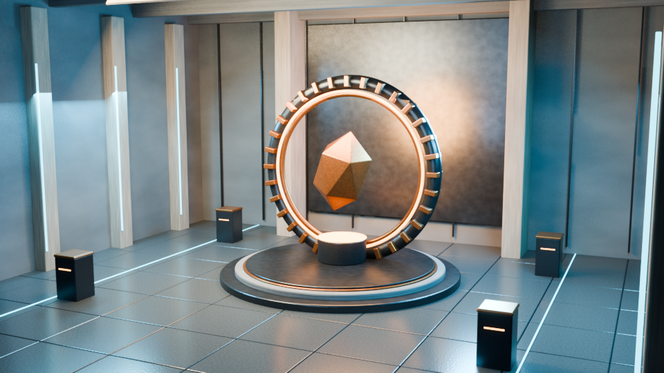

# BlendEngine grafikasi

Bu bosqich mavjud EEVEE rendererini ishlatadi: sifat profillari endi faqat loyiha
metadatasini emas, haqiqiy render sozlamalarini ham o'zgartiradi.

## Ishlatish

BlendEngine qo'shimchasini yoqing va Optimization sahifasidagi **Graphics &
Performance** bo'limini oching. **High** yoki **Cinematic** tugmasini bosing.
Ro'yxatdan profil tanlasangiz, **Apply Selected Profile** bilan qo'llang.
Qiymatlarni qo'lda tahrirlagandan keyin **Custom** tugmasini bosing.
Natijani Material Preview o'rniga **Rendered** ko'rinishida yoki F12 orqali ko'ring.

| Rejim | Viewport / render namunalari | Akslar | Asosiy maqsad |
|---|---|---|---|
| Ultra Low | 1 / 1 | O'chirilgan | Eng kam render xarajati |
| Low | 8 / 16 | O'chirilgan | Yengil qurilmalar |
| Balanced | 32 / 64 | O'chirilgan | Muvozanatli sahna |
| High | 64 / 128 | Next: yarim, legacy: to'liq aniqlikda | Desktop o'yin sahnalari |
| Cinematic | 128 / 256 | To'liq aniqlikda | Kuchli qurilmalar va rasm olish |

High va Cinematic rejimlari yumshoq soyalar, ambient occlusion, akslar va
yorqin joylardagi detallarni saqlovchi rang ishlovini sozlaydi. Blender 3.6 uchun
Filmic, 4.3 uchun AgX ishlatiladi. Ekspozitsiya va gamma saqlanadi.
3.6 da High soyalar 2048, Cinematic soyalar 4096 aniqlikda bo'ladi; EEVEE Next
o'zining shadow ray va shadow pool sozlamalarini ishlatadi.

Yangi Windows, Linux va macOS loyihalari High bilan boshlanadi. Magic Create
Game desktop uchun 1 GB rejimini majburan qo'llab, barcha chiroqlar soyasini
o'chirmaydi. Android/iOS uchun mavjud yengil profil saqlangan. Oldingi faylda
1 GB rejimi chiroqlar soyasini allaqachon o'chirgan bo'lsa, u chiroqlarning
**Shadow** sozlamasini keraklicha yoqing: sifat tugmasi chiroqlarni qayta yozmaydi.

Starter sahnalardagi tosh, yer, devor, yog'och va asfalt materiallarida
procedural rang, roughness va bump mavjud. Tashqi tekstura fayllari kerak emas.

## Namuna: Aperture Hall



Rasm: Blender 4.3.2 EEVEE Next, 960×540, 16 namuna. Dasturiy render uchun
rasmning namuna soni kamaytirilgan; to'liq aniqlikdagi akslar va Cinematic
soyalar saqlangan. Cinematic profilining odatiy render namunalari soni 256.

Sahna geometriyasi, PBR materiallari va yoritishi loyiha ichidagi Python
generatorida yaratiladi. Yuklab olinadigan modellar yoki teksturalar yo'q.
Generator faqat yangi, alohida ishga tushirilgan Blender sessiyasida qo'llanadi;
joriy sahna obyektlarini tozalaydi.

Repo ildizidan:

```bash
blender -b --factory-startup --python-exit-code 1 \
  --python tools/blendengine/create_graphics_showcase.py -- \
  --output-dir /tmp/blendengine-showcase --render
```

Natijalar: `aperture_hall.blend` va `aperture_hall.png`. `.blend` faylini
Blender/BlendEngine'da oching. Faqat sahnani yaratish uchun `--render` ni
olib tashlang. Windowsda `blender.exe` va o'zingizning chiqish papkangizni
ko'rsating. Rasm renderi uchun xotira va vaqt talab qilinadi; `--width 640
--height 360 --samples 24` bilan tezroq tekshirish mumkin.

## Tekshirish

```bash
blender -b --factory-startup --python-exit-code 1 \
  --python tests/python/blendengine_graphics.py
```

Linuxda rasmiy Blender 3.6.23 binary bilan 12 integratsion test o'tdi.
Blender 4.3.2 bilan 11 test o'tdi, manbadagi 3.6 starter generatoriga tegishli
bitta test ochiq ravishda o'tkazib yuborildi. Testlar haqiqiy bpy API orqali
sifatning o'zgarishi, Custom, Cycles/Workbench saqlanishi, sahna va compositor
saqlanishi, desktop yaratish oqimi, materiallar va faylni qayta ochishni tekshiradi.
Namuna sahna 3.6.23 da yaratilib saqlandi, 4.3.2 EEVEE bilan PNG render qilindi.
Bu natijalar o'zgartirilgan C/C++ manbasining to'liq build sinovi emas.

## Hozirgi chegaralar

- Sifat profili EEVEE uchun ishlaydi. Cycles yoki Workbench tanlangan sahnada
  renderer va uning sozlamalari almashtirilmaydi.
- EEVEE Next'da bloom compositor orqali yaratiladi. Profil mavjud compositor
  grafini o'zgartirmaydi; namuna sahnasida alohida yengil glow effekti bor.
- Volumetric sifat mavjud hajm materiallarini sozlaydi; profil tuman yaratmaydi
  yoki mavjud tuman materialini olib tashlamaydi. Legacy EEVEE uchun chiroq
  soyasini boshqarish chiroqning o'zida qoladi.
- FPS qiymatlari maqsadli budjetdir; o'lchangan tezlik yoki barcha qurilmalarda
  ishlash kafolati emas. FXAA belgisi EEVEE'da yengil temporal samplingga moslanadi.
- Bu Unreal'ning Lumen/Nanite tizimlari yoki beshta platformaga tayyor native
  eksport implementatsiyasi emas. Bu o'zgarish grafika bosqichiga tegishli;
  Android, iOS, macOS, Linux va Windows buildlari alohida tekshirilishi kerak.
