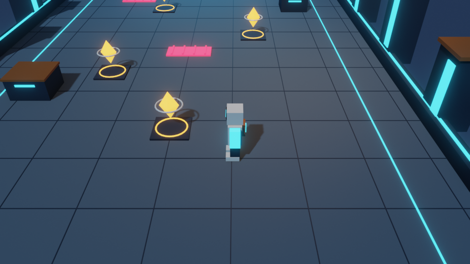
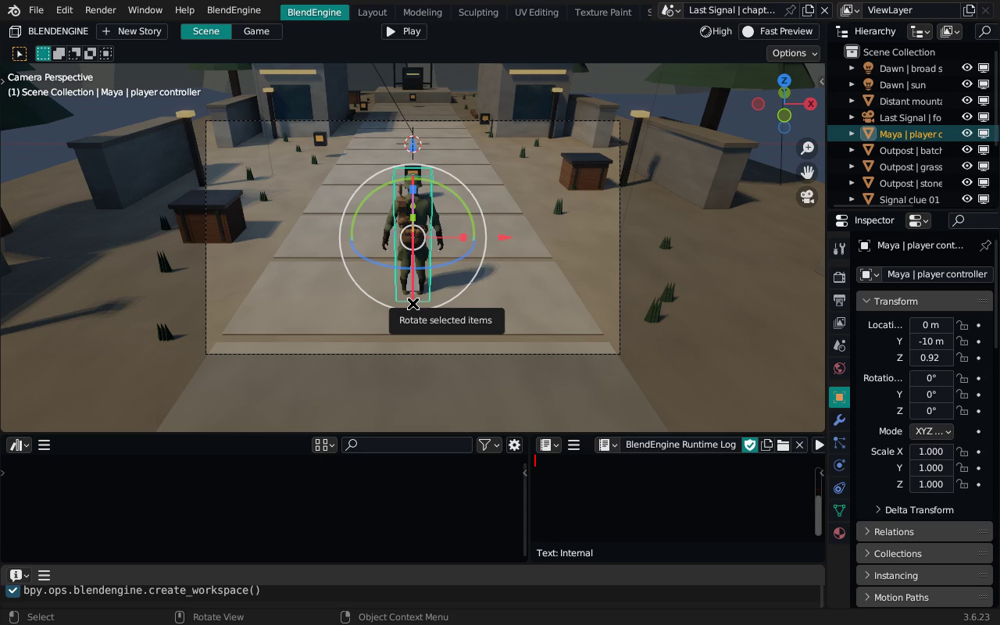

# Sifatni saqlovchi render va Last Signal

Render optimizatsiyasi sifat presetlarini almashtirmaydi. Resolution, TAA
namunalari, materiallar, yoritish, soyalar va akslar sozlamalari pasaytirilmaydi.
Bu o'zgarish Fast Preview yoki Workbench'ga o'tish hisobiga tezlik olmaydi.

## Render natijasi

Player/kamera koordinatasi o'zgarmagan bo'lsa ham eski runtime har safar uni
RNA orqali qayta yozgan. Blender buni render uchun yangi transform sifatida
qabul qilgan. Endi qiymat o'zgargandagina yoziladi; float32 komponentlar asl
setter saqlaydigan aniqlikda solishtiriladi. Grounding ichidagi vaqtinchalik
pastga siljish va darhol qaytarish o'rniga aynan bir xil yakuniy koordinata
bir marta yuboriladi. Haqiqiy yurish, sakrash yoki kamera harakati tashlanmaydi.

Bir xil Blender 3.6.23, Neon Relay statik Lit sahnasi, kamera, yorug'lik,
material va render sozlamalari bilan:

| O'lchov | Oldin | Keyin |
|---|---:|---:|
| Viewport median qayta chizilishi | 4.007 Hz | 12.463 Hz |
| Median kadr vaqti | 249.551 ms | 80.235 ms |
| 30 idle qadamdagi object yangilanishi | 90 | 0 |

Bu **3.11× statik viewport tezlashishi**. Harakatdagi barcha sahnalar yoki GPU'lar
uchun bir xil tezlashish kafolatlanmaydi. Sinovda player/kameraning 60 qadamlik
yurish va sakrash yo'li aynan teng bo'lgan. 960×540 reference renderlardagi piksel
farqi **max 0 / MAE 0**; PNG metadata baytlari farq qilishi mumkin.
[O'lchov va tasvir tengligi dalili](render/quality_report.json).



Native qayta o'lchash (bir displeyda ketma-ket, yangi processlarda):

```bash
DISPLAY=:93 blender --factory-startup --python-exit-code 1 \
  --python tools/blendengine/benchmark_render.py -- \
  --addon-path /path/to/baseline-addon-parent \
  --scene /path/to/neon_relay.blend --output /tmp/render-before \
  --gui --frames 20 --render-evidence
```

Keyingi run uchun `--addon-path scripts/addons_core` va boshqa output papkasini
tanlang. Benchmark real Lit viewport draw callbacklarini o'lchaydi; F12 render
vaqti FPS deb ko'rsatilmaydi. Reference PNGlar o'sha saqlangan to'liq render
sozlamalari bilan olinadi. `--gui` siz transform/quality/trajectory tekshiruvi
headless ishlaydi.

## Last Signal / birinchi bob

Bo'ron tog'dagi aloqa postini ishdan chiqargan. Dala muhandisi Maya yo'qolgan
akasi Eli qoldirgan xabarlarni topadi, batareya va aloqa qismlarini yig'adi va
rescue beacon'ni tiklaydi. Bobning boshlanishi, beshta objective/dialogue bosqichi
va yakuni bor. Bu birinchi o'ynaladigan bob; to'liq uzun metrajli o'yin emas.

- Robot o'rniga anatomik odam modeli, skinning skeleti va masofaga bog'langan
  yurish animatsiyasi bor. Model repodagi mavjud NeonQuarantine soldier
  geometriyasidan qayta ishlatilgan; kiyim, teri va jihozlar procedural PBR
  materiallar bilan yangilangan. Upstream asset shartlari saqlanadi; tashqi
  model yoki tekstura yuklab olinmaydi.
- Beton/po'lat/teri/kiyim yuzalari, haqiqiy quyosh soyasi, service lights,
  qarag'aylar, tog' silueti va post jihozlari mavjud. Geometriya statik batchlarga
  yig'ilgan: 16 obyekt, taxminan 21 ming source uchburchak. Bevel va skinned
  meshning evaluated natijasi source sonidan ko'proq bo'lishi mumkin.
- Sahna High EEVEE/Lit bilan saqlanadi. Realistic uslub yaxshilangan, lekin
  fotorealizm yoki barcha qurilmalarda 60 FPS va'da qilinmaydi.

Native BlendEngine oynasidagi **New Story** tugmasi bobni alohida scene sifatida
yaratadi. Play bosing: WASD yurish, Shift yugurish, Space sakrash, E terminalni
tekshirish, R restart, Esc Stop. Besh objective topilib minoraga yetilganda
yakun ochiladi. Stop kamera va personajning boshlang'ich holatini tiklaydi.

```bash
blender -b --factory-startup --python-exit-code 1 \
  --python tools/blendengine/create_story_game.py -- \
  --output-dir /tmp/last-signal
```

`LastSignal.blend` Blender 3.6.23 bilan yaratiladi; qo'shimchani yoqib oching.
Android uchun bobning alohida native Godot C++ / OpenGL ES adapteri ham bor:
[APK, boshqaruv va build](ANDROID.md). Androiddagi yoritish va tone mapping
EEVEE'dan farq qiladi. Besh platformali tayyor release deb da'vo qilinmaydi.



Editor oynasidagi haqiqiy klaviatura bilan olingan 144,35 soniyalik video
va beshta objective bilan yakun ochilganini tasdiqlovchi
[recording hisoboti](story/recording_summary.json) mavjud. Video capture 20 FPS;
bu o'yinning render FPS o'lchovi emas. Hisobotdagi Lit viewport tezligi
ushbu CPU software-rendering muhitiga tegishli.

## Tekshiruv

Yangi render regressiyalari teng qiymatdagi RNA yozuvlarini, idle depsgraph
yangilanishining yo'qligini va haqiqiy harakat saqlanishini tekshiradi.
Story testi haqiqiy input holati orqali beshta izni yig'adi, yakunni ochadi,
restart va Stop holatini tekshiradi. Ikkalasi Blender 3.6.23 hamda 4.3.2 da o'tadi.

```bash
blender -b --factory-startup --python-exit-code 1 --python tests/python/blendengine_render.py
blender -b --factory-startup --python-exit-code 1 --python tests/python/blendengine_story.py
```

Avvalgi grafika, runtime va Neon Relay testlari ham saqlangan. To'liq
o'zgartirilgan C/C++ engine buildi bu bosqichda bajarilmagan.
