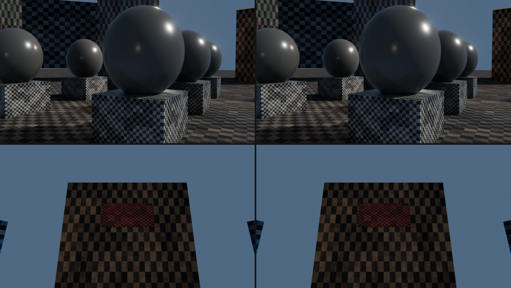

# Smart Optimizer va runtime optimizatsiya

[README](../README.md) · [Grafika](GRAPHICS.md) · [Loyiha xaritasi](PROJECT_GUIDE.md)

Render Blender'ning o'zida (EEVEE) va eng yuqori sozlamada qoladi. Optimizator
rendererni soddalashtirmaydi: u **kamera hech qachon ko'rmaydigan yoki ekran
pikseli ajrata olmaydigan** ma'lumotni olib tashlaydi, shunda renderer faqat
kadrga tushadigan narsaga pul to'laydi.

Bu o'rgatilgan neyron tarmoq emas. Bu o'lchov va qoidalarga asoslangan
rejalashtiruvchi: har bir qadam bitta qaror, uning sababi va kutilgan tejami
hisobotga yoziladi.

## Ishlatish

3D ko'rinish yon paneli → **Optimize** → **Smart Optimizer** →
**Smart Optimize Scene**. Yoki yuqori menyu: BlendEngine → Smart Optimize Scene.

- Hisobot Text Editor'dagi `BlendEngine Smart Optimizer` blokiga yoziladi.
- **Restore Originals** asl mesh, rasm va yashirilgan obyektlarni qaytaradi.
- **Discard Originals** saqlangan asllarni o'chiradi (fayl kichrayadi, qaytarib
  bo'lmaydi).
- Rasm o'lchami Blender Undo bilan qaytmaydi — **Restore Originals** ishlating.
  Birlashtirilgan materiallar esa faqat Undo bilan qaytadi (ular aynan bir xil
  bo'lgani uchun rasm o'zgarmaydi).
- Hech qachon ko'rinmaydigan obyektlar viewport'da ham yashiriladi; ular
  **Restore Originals** bilan qaytadi.

Skriptdan:

```python
import bpy
from blendengine import smart_optimizer

report = smart_optimizer.optimize(bpy.context)
print(smart_optimizer.report_text(report))
smart_optimizer.restore(bpy.context.scene)
```

## Kamera qayerda bo'lishi mumkin

Hamma narsa shu savoldan boshlanadi. **Viewpoints** sozlamasi:

| Rejim | Nuqtalar |
|---|---|
| Play Area | O'yinchi tura oladigan pol ustidagi to'r; har nuqtadan har tomonga qaraladi |
| Camera Path | Sahna kamerasining kadrlar oralig'idagi har bir holati va uning kadri |
| Automatic | Player Controller bor bo'lsa Play Area, bo'lmasa Camera Path |

Play Area'da pol — `Ground` tegi qo'yilgan obyektlar (runtime o'yinchini aynan
shular ustida yurgizadi); teg bo'lmasa yuqoriga qaragan barcha statik sirtlar.
O'yinchi turgan joydan **Climb Height** dan baland bo'lmagan pog'onalar bilan
yetib boriladigan pol hisobga olinadi. Kamera balandligi va siljishi sahnadagi
o'yinchi va kameradan o'lchanadi (birinchi shaxs: ko'z balandligi; uchinchi
shaxs: runtime ishlatadigan o'sha siljish).

Chiroqlar va light probe'lar ham "kuzatuvchi": faqat chiroq ko'radigan sirt
soya tashlashi mumkin, shuning uchun u saqlanadi.

## Bosqichlar

| Bosqich | Nima qiladi | Rasm |
|---|---|---|
| Materiallar | Bir xil materiallarni birlashtiradi, hech bir yuz ishlatmaydigan slotlarni olib tashlaydi | O'zgarmaydi |
| Mesh'lar | Bayt-ma-bayt bir xil mesh'li obyektlar bitta mesh'ni ulashadi (instancing) | O'zgarmaydi |
| Ko'rinmas yuzlar | Hech bir nuqta, chiroq yoki probe ko'rmaydigan yuzlarni o'chiradi | O'zgarmaydi* |
| Ko'rinmas obyektlar | Hech qachon ko'rinmaydigan va yoritilmaydigan statik obyektni renderdan chiqaradi | O'zgarmaydi* |
| Teksturalar | Har rasmni ekran pikseli ajrata oladigan eng katta o'lchamgacha kichraytiradi | O'zgarmaydi* |
| Occlusion (PVS) | Har pol katagidan qaysi obyektlar ko'rinishini saqlaydi; runtime qolganini chizmaydi | O'zgarmaydi* |
| LOD | Uzoqdagi obyekt uchun soddalashtirilgan mesh'lar; ekranda 8 pikselga kamida 1 uchburchak qoladigan masofada almashadi | Chegaralangan farq |

\* Tahlil qilingan nuqtalar va maqsad ekran o'lchami uchun. Tahlil namunaviy:
pastdagi "Chegaralar" bo'limiga qarang.

Harakatlanadigan narsalarga tegilmaydi: o'yinchi, NPC, sog'liq komponenti,
behavior'li yoki boshqa behavior nishoni bo'lgan obyekt, animatsiya, constraint,
active rigid body, armature/shape key. Rigid body'li obyektning yuzlari ham
o'chirilmaydi. Shaffof, alfa yoki transmission'li material to'siq hisoblanmaydi.

### Teksturalar: sifatni yo'qotmasdan qanday kichrayadi

GPU uzoqdagi sirt uchun teksturaning kichik mip darajasini o'qiydi. Kamera
sirtga hech qachon yaqinlasha olmasa, katta darajalar hech qachon o'qilmaydi —
ular faqat xotirani egallaydi.

Har uchburchak uchun ikkita son hisoblanadi:

- **teksel/metr** — UV yoyilmasidan, tekstura eng cho'zilgan yo'nalish bo'yicha
  (Mapping tugunidagi takrorlash hisobga olinadi);
- **piksel/metr** — kameraning eng yaqin kelishi mumkin bo'lgan masofasi va
  maqsad ekran o'lchamidan, kadr burchagidagi perspektiva cho'zilishi bilan.

Rasm faqat eng talabchan uchburchakda ham **1 pikselga kamida 1 teksel**
(`Texels Per Pixel`) qoladigan darajagacha ikkiga bo'linadi. O'yinchi tegib
ko'ra oladigan sirt (masofa `Closest Approach`, standart 0.5 m) odatda to'liq
o'lchamda qoladi; tom, baland lavha, uzoq manzara kichrayadi.

O'lchab bo'lmaydigan rasmga tegilmaydi: World/HDRI, node group ichidagi, UV'siz
(Object/Generated koordinata, Box projection), boshqa sahna yoki brush
ishlatadigan, video/UDIM rasmlar.

Asl rasm diskda bo'lsa, o'sha fayl manba bo'lib qoladi; bo'lmasa `.blend`
ichida `BE_ORIG_` nomi bilan saqlanadi.

### Byudjet baribir oshsa

`Allow Visible Trade-offs` o'chiq (standart) bo'lsa, optimizator ko'rinadigan
hech narsani qurbon qilmaydi va byudjetdan qancha oshganini hisobotda aytadi.
Yoqilsa, tekstura byudjetiga sig'guncha teksel zichligi butun ekran bo'ylab
bir tekis pasaytiriladi (0.7 → 0.5 → 0.35 → 0.25 teksel/piksel). Bu ko'rinadigan
yo'qotish; hisobotda "bounded trade-off" deb belgilanadi.

## O'yin vaqtida (Test Run va desktop eksport)

`runtime_optimizer.SceneCuller` har 5 kadrda:

- **Frustum** — obyektning chegaralovchi sferasi kamera piramidasidan to'liq
  tashqarida bo'lsa chizilmaydi (avval obyekt markazi bo'yicha qo'pol tekshiruv
  edi: markazi kamera ortida qolgan katta pol yo'qolib qolardi). EEVEE Next'da
  `Use Frustum Culling Strategy` yoki `Unload Behind Camera`, legacy EEVEE'da
  faqat `Unload Behind Camera` yoqilganda ishlaydi.
- **Occlusion** — kamera turgan katak va 8 qo'shnisining saqlangan ko'rinuvchi
  to'plamida yo'q statik obyekt chizilmaydi. Kamera tahlil qilingan maydondan
  chiqsa, occlusion o'chadi.
- **LOD** — masofaga qarab tayyor mesh'lar almashadi.
- Mavjud oqim radiusi va `Max Visible Objects` chegarasi saqlangan.

EEVEE Next'da (Blender 4.2+) kadrdan tashqaridagi obyekt o'chirilmaydi, faqat
kameraga ko'rinmas qilinadi (`visible_camera`), shuning uchun **soyasi joyida
qoladi**. Legacy EEVEE (3.6) bunday rejimni bilmaydi: u yerda obyekt
yashiriladi va soyasi ham yo'qoladi. Test Run to'xtaganda hamma holat qaytariladi.

`QualityGovernor` (`Dynamic Resolution` yoqilgan bo'lsa) kadr vaqtini o'lchaydi.
Maqsad FPS ushlanmasa bir pog'ona tushadi, uch marta ketma-ket zaxira bo'lsagina
qaytadi:

1. akslar va bilvosita yorug'lik past ichki aniqlikda;
2. hajmiy effektlar dag'alroq;
3. soya nurlari va qadamlari kamroq;
4. AO/GI, bloom, motion blur o'chadi;
5. oxirgi chora: viewport 2×2 piksel bilan chiziladi, ray tracing o'chadi.

EEVEE viewport'i erkin render o'lchamini bermaydi, shuning uchun "dynamic
resolution" effektlar aniqligi orqali amalga oshiriladi.

## O'lchov

`tools/blendengine/optimizer_benchmark.py` ataylab isrofgar sahna quradi
("Bazaar": har yashik o'z mesh va material nusxasi bilan, binolar ichida
ko'rinmas jihozlar, balandda 2K lavhalar, 4K ufq), o'yinchi nuqtalaridan
optimizatsiyadan oldin va keyin EEVEE bilan render qiladi va kadrlarni
piksel-ma-piksel solishtiradi.

```bash
blender -b --factory-startup --python-exit-code 1 \
  --python tools/blendengine/optimizer_benchmark.py -- \
  --output-dir /tmp/blendengine-benchmark --render --samples 8
```

<!-- benchmark:start -->
Blender 4.3.0, EEVEE Next, 1280×720, 8 namuna, depth of field o'chiq (eng qat'iy taqqoslash uchun).
Tahlil: 78 nuqta, 44 soniya.

| Ko'rsatkich | Oldin | Keyin | Tejam |
|---|---:|---:|---:|
| Render qilinadigan uchburchaklar | 126008 | 72034 | 43% |
| Draw call (obyekt × material sloti) | 158 | 80 | 49% |
| Tekstura xotirasi (mip bilan) | 725 MB | 341 MB | 53% |
| Materiallar | 122 | 24 | 80% |
| Mesh datablock'lar | 119 | 26 | 78% |

Rasm farqi (oldin va keyin, bir xil kamera, 8-bit PNG):

| Kadr | PSNR | O'rtacha farq (255 dan) | 8 darajadan ko'p farq qilgan piksellar |
|---|---:|---:|---:|
| street | 64.7 dB | 0.022 | 0.000% |
| crates | 64.0 dB | 0.025 | 0.000% |
| statues | 66.7 dB | 0.014 | 0.000% |
| sign | 71.8 dB | 0.004 | 0.000% |

Runtime (maydon bo'ylab 48 qadamli aylanma yurish, frustum + occlusion + LOD): kameraga o'rtacha obyektlarning 20% i va optimizatsiyadan keyingi uchburchaklarning 26% i yuboriladi.



`sign` kadri — optimizator ikki barobar kichraytirgan lavha (2048 → 1024) ostidagi, unga eng yaqin turish mumkin bo'lgan nuqta. 12 ta rasm kichraydi: 4 ta ufq paneli (4096 → 2048) va uzoqdagi 8 ta lavha; o'yinchi yaqin bora oladigan 4 ta lavha, yer, yashik va fasad teksturalari to'liq o'lchamda qoldi.

Chapda asl sahna, o'ngda optimizatsiyadan keyingi sahna. Render vaqti bu yerda keltirilmagan: o'lchov GPU'siz, dasturiy rasterizatorda (llvmpipe) bajarilgan va haqiqiy qurilmadagi FPS haqida xulosa bermaydi.

Byudjet qarori: sahna uchun 256 MB tekstura byudjeti berilgan edi. Rasmni o'zgartirmaydigan bosqichlardan keyin 341 MB qoldi va optimizator buni hisobotda aytdi; `Allow Visible Trade-offs` o'chiq bo'lgani uchun ko'rinadigan sifatga tegmadi.
<!-- benchmark:end -->

## Tekshirish

```bash
blender -b --factory-startup --python-exit-code 1 \
  --python tests/python/blendengine_optimizer.py
```

25 integratsion test haqiqiy `bpy` API orqali kichik sahnalar quradi (Blender 4.3.0 va 5.3.0 `bpy` modullarida o'tdi; 3.6 da ishga tushirilmagan): nima
o'chirilishi va, eng muhimi, nimaga tegilmasligi tekshiriladi (harakatlanuvchi
obyektlar, shisha ortidagi narsa, faqat quyosh ko'radigan tom, o'lchab
bo'lmaydigan teksturalar, mualliflik compositor grafi).

## Chegaralar

- **Telefonda EEVEE ishlamaydi.** Blender'ning Android/iOS versiyasi yo'q;
  repodagi Android/iOS/Web eksporti hozircha 2D WebView scaffold'i. Optimizator
  aktivlarni maqsad ekran o'lchamiga (masalan 1280×720) tayyorlaydi, lekin
  telefonda EEVEE sifatida render qiladigan runtime bu repoda yo'q.
- **Tahlil namunaviy, isbot emas.** Nuqtalar to'rda, har uchburchak bir necha
  nuqtada tekshiriladi. Xavfsizlik uchun ko'rinadigan yuz atrofidagi bir halqa
  qo'shni yuz va masofa zaxirasi saqlanadi. Tor tirqish orqali ko'rinadigan
  sirt o'tkazib yuborilishi mumkin: `Viewpoint Spacing` ni kichraytiring yoki
  `Safety Margin` ni oshiring. Biror sirt yo'qolsa — **Restore Originals**.
- Runtime o'yinchini devorlardan to'xtatmaydi. O'yinchi yopiq jism ichiga kirsa,
  uning ichki yuzlari chizilmaydi.
- Play Area kamerani runtime'dagi qat'iy siljish bilan modellashtiradi. Kamerani
  o'z behavior'ingiz bilan boshqa joyga olib borsangiz, Camera Path rejimidan
  yoki kattaroq zaxiradan foydalaning.
- Planar reflection probe (legacy EEVEE) ko'zgu ortidagi yuzlarni ko'rsatishi
  mumkin; ular alohida tekshirilmaydi.
- LOD — ko'rinadigan (chegaralangan) farq; decimation UV va siluetni biroz
  o'zgartiradi. F12 render har doim to'liq mesh'ni ishlatadi.
- Tahlil Python'da: benchmark sahnasida (126 ming uchburchak, 78 nuqta) taxminan
  44 soniya.
