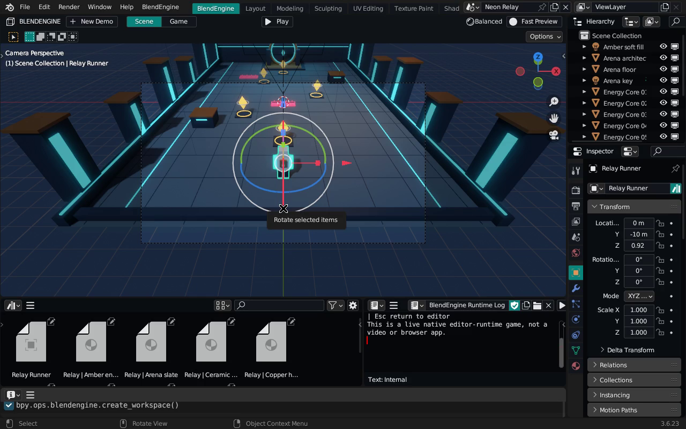
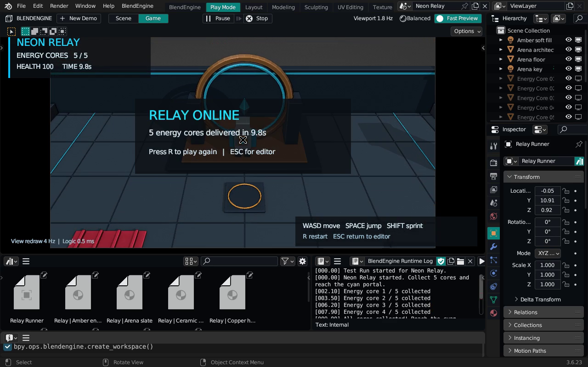

# Native editor, optimizatsiya va Neon Relay

BlendEngine ichida yangi Scene/Game ish jarayoni va o'ynaladigan kichik o'yin
mavjud. UI Blender'ning native oynalari va EEVEE rendereriga tayangan.



## Editor

BlendEngine qo'shimchasini yoqing va **Create BlendEngine Workspace** buyrug'ini
chaqiring. Editor markazida Scene/Game ko'rinishi, yonida Hierarchy va Inspector,
pastida Project Assets va Runtime Output joylashadi. Layout bir marta yaratiladi;
shu ish maydonini qayta ochish docklarni ko'paytirmaydi.

- **Play**: sahnani tekshiradi va haqiqiy runtime sessiyasini boshlaydi.
- **Pause / Resume**: o'yin mantiqini vaqtincha to'xtatadi/davom ettiradi.
- **Step**: pauzada bitta simulyatsiya qadamini bajaradi.
- **Stop / Esc**: sessiyani tugatadi; Scene tugmasi tahrirlash ko'rinishiga qaytaradi.
- **Scene / Game**: tahrirlash va kamera ko'rinishlari orasida o'tadi.
- **Neon Relay**: alohida namuna sahnasini yaratadi.
- **Fast Preview**: Workbench material ranglari bilan yengil viewport rejimi.
  Yana bossangiz avvalgi yoritilgan ko'rinish qaytadi. Bu real vaqtli prototip
  uchun sifat/tezlik tanlovi; EEVEE sozlamalari, materiallar va F12 renderi
  o'zgarmaydi.

Game view klaviatura bilan boshqariladi. Header va Inspector tugmalari runtime
tomonidan yutib yuborilmaydi. Timer real o'tgan vaqtni ishlatadi, katta tanaffus
uchun qadam 0.1 soniya bilan cheklanadi; pauzadan chiqish katta sakrash yaratmaydi.

## O'ynaladigan namuna

**Neon Relay** — beshta energiya yadrosini yig'ib, cyan portalga yetib borish
vazifasi. WASD bilan yuring, Space bilan sakrang, Shift bilan yuguring.
Qizil xavflar sog'liqni kamaytiradi. Beshta yadrodan oldin portal yopiq;
sog'liq tugasa yutqazasiz. R qayta boshlaydi, Esc o'yinni to'xtatadi.

Sahna 15 ta obyekt va 5112 ta uchburchakdan foydalanadi. Arxitektura umumiy
meshlar ichiga birlashtirilgan, materiallar procedural. Tashqi asset yoki tekstura
kerak emas. Yangi Blender sessiyasida repo ildizidan:

```bash
blender -b --factory-startup --python-exit-code 1 \
  --python tools/blendengine/create_playable_demo.py -- \
  --output-dir /tmp/blendengine-playable
```

Hosil bo'lgan `neon_relay.blend` faylini Blender 3.6.23/BlendEngine'da oching,
qo'shimchani yoqing va Play bosing. Bu native editor ichidagi haqiqiy o'yin
sessiyasidir; alohida `.exe`, APK yoki iOS ilovasi eksporti hisoblanmaydi.

## Runtime optimizatsiyasi

Har tick'dagi takroriy sahna skanlari bitta role index orqali ishlaydi.
Collider'lar barcha juftlikni tekshirish o'rniga sweep broadphase orqali
yaqin nomzodlarga ajratiladi. Hodisalar tartibi saqlanadi; collision harakati
obyektni o'sha tick'da ko'chirsa, qolgan juftliklar uchun aniq fallback ishlaydi.
Asset statistikalari har 10 tick'da qayta sanalmaydi: ularning yangilanishi vaqt
va strukturaviy o'zgarishlarga bog'langan. Ko'rinadigan uchburchaklar sonini
hisoblashda har polygon ustidan Python sikli o'tmaydi.

Bir xil Blender 3.6.23 muhitida, 394 obyekt/389 collider, 240 o'lchangan qadam va
20 warmup qadam bilan:

| CPU simulyatsiya vaqti | Oldin | Keyin |
|---|---:|---:|
| Median | 166.374 ms | 6.106 ms |
| p95 | 190.088 ms | 7.642 ms |

Median hisoblash 27.25 baravar tezlashdi. Boshlang'ich konfiguratsiya va yakuniy
o'yin holati aynan bir xil: player joylashuvi, sog'liq, trigger kirishlari va
aktiv collision juftliklari tekshirilgan. Oxirgi qadamda 75 466 ta mumkin bo'lgan
juftlik o'rniga bitta broadphase nomzodi tekshirildi. Natijalar:
[oldingi JSON](../artifacts/runtime/baseline_blender36.json) va
[keyingi JSON](../artifacts/runtime/optimized_blender36.json).

Benchmarkni qayta bajarish:

```bash
blender -b --factory-startup --python-exit-code 1 \
  --python tools/blendengine/benchmark_runtime.py -- \
  --output /tmp/runtime-after.json --label after \
  --compare artifacts/runtime/baseline_blender36.json
```

Bu sonlar CPU'dagi `GameSession.step` hisoblash vaqti. Ular render FPS'i emas.
HUD **Update Hz**, **Logic ms** va **Viewport redraw Hz** ni alohida ko'rsatadi.
Boshlang'ich qiymat maqsadli FPS bilan soxtalashtirilmaydi. GPU, ekran o'lchami,
material, yoritish va ekran yozuvi xarajati haqiqiy viewport tezligiga ta'sir qiladi.

## Tekshirish va ekran yozuvi

```bash
blender -b --factory-startup --python-exit-code 1 --python tests/python/blendengine_graphics.py
blender -b --factory-startup --python-exit-code 1 --python tests/python/blendengine_runtime.py
blender -b --factory-startup --python-exit-code 1 --python tests/python/blendengine_demo.py
```

Runtime testlari input, sakrash, trigger, collision hodisalari tartibi,
teleport/spawn/delete holatlari va yangi cache'lar xulqini tekshiradi.
O'yin testi haqiqiy input holati orqali barcha yadrolarni yig'ib yutadi,
yopiq portal, xavf/sog'liq, restart va Stop'dan keyingi kamera holatini tekshiradi.

Ekran videosini qayta olish uchun X11 displey, FFmpeg va xdotool kerak:

```bash
python3 tools/blendengine/record_editor_demo.py \
  --display :92 --blender /path/to/blender \
  --scene /tmp/blendengine-playable/neon_relay.blend \
  --output-dir /tmp/blendengine-recording --fast-preview
```

Recorder native Blender oynasini ishga tushiradi, faqat haqiqiy OS klaviatura
hodisalari bilan o'yinni boshqaradi va X11 oynasini yozadi. Telemetriya JSON/JSONL
fayllari video yonida saqlanadi. Capture FPS video kadr chastotasidir; u o'yinning
render FPS'i sifatida talqin qilinmaydi. Offline animatsiya yoki AI video
o'yin bajarilganining dalili sifatida ishlatilmaydi.

Yozib olingan haqiqiy sinov: 1280×800, taxminan 66 soniya, 5/5 yadro va
100 sog'liq bilan yutuq. Video tezlashtirilmagan. Shu Xvfb sinovida o'yin paytidagi
median viewport qayta chizilishi Lit rejimida 1.689 Hz (8 ta o'lchov), Fast
Preview'da 3.886 Hz (88 ta o'lchov) bo'ldi. Bu qisqa, bir muhitdagi sifat rejimlari
taqqoslanishidir; Fast Preview yoritilgan PBR ko'rinishi bilan bir xil sifat
berishini yoki boshqa qurilmada bir xil tezlikni kafolatlamaydi.
Video 24 FPS capture bilan so'ralgan, amaldagi faylda ayrim capture kadrlari
tushgan (o'rtacha 20.57 FPS); bu sonlarning hech biri o'yin FPS'i emas.
[Yozuv natijalari](editor/recording_summary.json) telemetriya va input hodisalarini
saqlaydi. Yutuqdan so'ng Lit ko'rinishi, player va kamera holati tiklanib saqlandi.



Tekshirish: Blender 3.6.23 bilan 12 grafika + 14 runtime + 4 o'yin testi
(jami 30) o'tdi. Blender 4.3.2 bilan runtime va o'yin testlari o'tdi;
avvalgi grafika moslik sinovida 11 test o'tgan va manba-3.6 starteriga tegishli
bitta test o'tkazib yuborilgan. Native UI ochilishi, Fast Preview sozlamalarining
tiklanishi, Pause/Step/Resume/Stop va OS-keyboard orqali yutuq amalda tekshirildi.

To'liq o'zgartirilgan C/C++ engine buildi va barcha beshta platforma eksporti
bu bosqichda tekshirilmagan. Tekshiruvlar rasmiy Blender binary + loyiha
qo'shimchasi yordamida bajariladi.
