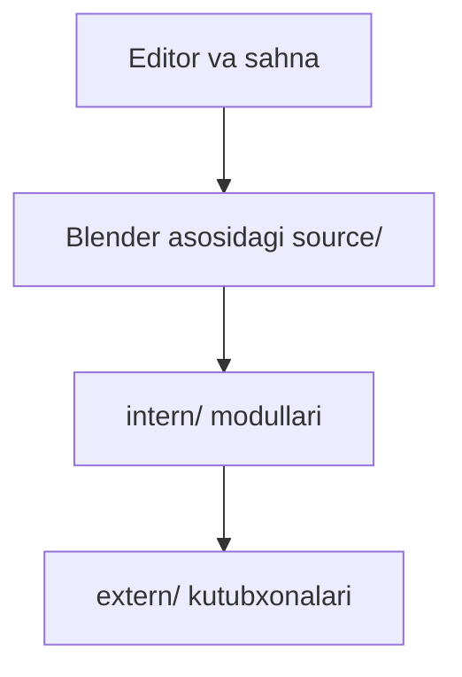

# BlendEngine — loyiha xaritasi

[README](../README.md) · [Roadmap](../ROADMAP.md) · [Baholash](EVALUATION.md) · [Reliz tartibi](RELEASING.md)

## Maqsad

Blender manba asosida interaktiv 3D izlanishlar.

**Texnologiyalar:** C / C++ · CMake · Python.

## Arxitektura va oqim

Asosiy oqimning ixcham xaritasi; batafsil xulq manba kodida berilgan.



## Boshlang‘ich misol

Quyidagi buyruqlarni README dagi talablar va sozlash bosqichlaridan keyin, repozitoriy ildizidan bajaring:

```bash
cmake -S . -B ../blendengine-build
cmake --build ../blendengine-build --parallel
```

Avval platformaga mos compiler va dependency to‘plamini tayyorlang. Bu barcha platformada sozlamasiz build kafolati emas.

Bu qo‘llanma misolni ushbu hujjat yangilanishi vaqtida bajarilgan test sifatida ko‘rsatmaydi. Test dalili, qurilma va natija baholash hisobotida alohida saqlanadi.

## Manba xaritasi

[source](../source) · [intern](../intern) · [extern](../extern) · [scripts](../scripts) · [build_files](../build_files) · [COPYING](../COPYING)

## Ish jarayoni

1. Lokal yoki test muhitini tayyorlang.
2. Yuqoridagi eng kichik oqimni tekshiring.
3. Ta’sirlangan modulning testini bajaring.
4. Faqat haqiqiy natijalarni hisobotga kiriting.

[Hissa qo‘shish](../CONTRIBUTING.md) · [O‘zgarishlar](../CHANGELOG.md)
